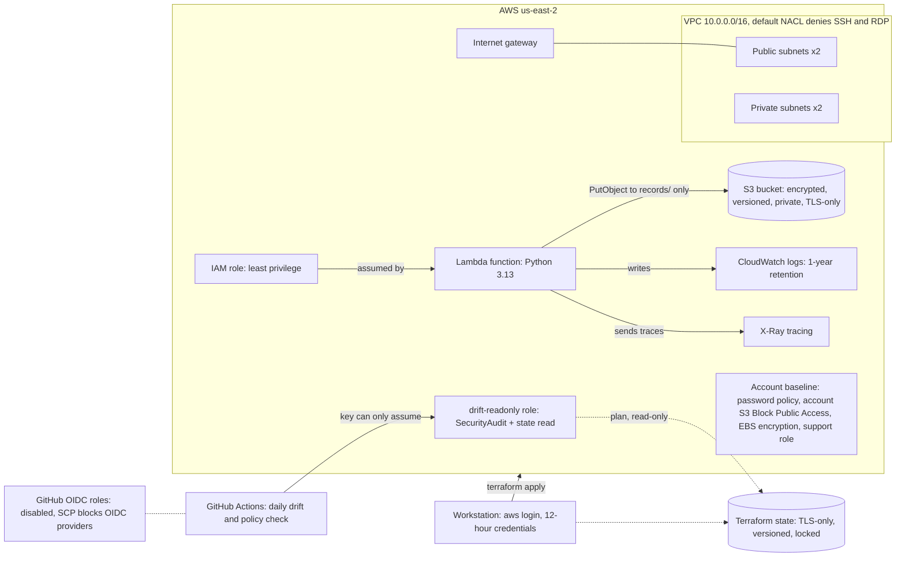

# devsecops-lab

AWS infrastructure built with Terraform, secured by a GitHub Actions pipeline that runs SAST, SCA and IaC scanning and blocks any change that fails a check.

> **Status: deployed.** The lab runs in AWS us-east-2, built from code that is validated and security-scanned (Checkov: 223 passed, 0 failed, 17 documented exceptions). Every pull request is scanned automatically by GitHub Actions, and a scheduled workflow checks for drift between the code and live AWS every day.

## Architecture



## What's built

| Component | Resources |
| --- | --- |
| `network` | VPC across two availability zones, public and private subnets, internet gateway, route tables, locked default security group, default NACL denying SSH and RDP |
| `storage` | S3 bucket with public access blocked, ACLs disabled, versioning, encryption and a TLS-only bucket policy |
| `app` | Python Lambda function, least-privilege IAM role, CloudWatch log group, X-Ray tracing |
| `account-baseline` | Account-wide CIS settings: IAM password policy, account-level S3 Block Public Access, EBS default encryption, AWS Support role |
| `github-oidc` | Keyless GitHub Actions login: read-only plan role for pull requests, apply role limited to the `prod` environment |
| `bootstrap` | Hardened Terraform state bucket with S3 native locking, plus the read-only drift-check identity (`drift-check-ci` user and `drift-readonly` role) |

## Security decisions

- **Least-privilege Lambda role.** The function can write to its own log group, upload objects under one prefix of one bucket, and send traces. Nothing else.
- **CI credentials.** The design is keyless: GitHub Actions authenticates to AWS through OIDC with short-lived credentials. No AWS keys are stored anywhere. Trust policies only accept this repository, and the apply role only accepts the manually approved `prod` environment. In the current lab account, organization policy blocks creating OIDC identity providers, so the module is disabled with `enable_github_oidc = false` and deploys run from a workstation using short-lived `aws login` credentials. The one exception is a read-only drift-check key, documented in [EXCEPTIONS.md](EXCEPTIONS.md): it can only assume a read-only role, and it rotates every 90 days.
- **S3 locked down by default.** All four public access block settings on, ACLs disabled with `BucketOwnerEnforced`, versioning and encryption at rest.
- **Hardened state.** The state bucket rejects any request not made over TLS, keeps old versions for 90 days, and is protected from deletion with `prevent_destroy`.
- **Default security group locked.** No inbound or outbound rules.
- **Default NACL managed.** All four subnets use it, and it denies SSH (22) and RDP (3389) from anywhere before any allow rule.
- **Account baseline in code.** Password policy, account-level S3 Block Public Access, EBS default encryption and an AWS Support role are Terraform resources, so the daily drift check covers them too.
- **Every policy validated.** Each IAM, trust and bucket policy is checked with IAM Access Analyzer before every pull request and daily in CI.
- **No NAT Gateway.** Private subnets have no internet route, a deliberate cost and attack-surface decision.
- **Pinned dependencies.** Terraform and provider versions are pinned, and lock files hold checksums for Linux, macOS and Windows.

## Security scanning

Infrastructure code is scanned with [Checkov](https://www.checkov.io/).

| Result | Count |
| --- | --- |
| Passed | 223 |
| Failed | 0 |
| Skipped (documented) | 17 |

The code has 17 `#checkov:skip` comments covering 13 distinct checks (several apply to both S3 buckets), and all 17 apply in the current scan.

Every finding was either fixed or accepted with a written reason. Accepted findings are marked in the code with `#checkov:skip` comments and listed with their compensating controls in [EXCEPTIONS.md](EXCEPTIONS.md).

## Custom policies

`policies/require_tags.yaml` defines **CKV2_LAB_1**, which requires `Project`, `Environment` and `Owner` tags on the resource types listed in the policy (VPC, subnets, route tables, buckets, roles, users, the Lambda function and others). CI runs it on every pull request with `--external-checks-dir policies`.

Findings while building it:
- Checkov does not read the AWS provider's `default_tags`, so tags are passed to each module and set on each resource explicitly. `default_tags` remains as a backup.
- A missing space in the CI command (`policies--quiet`) once pointed Checkov at a directory that didn't exist, so CKV2_LAB_1 silently stopped running in CI while the job stayed green. Fixed 2026-10-23. A scan that passes can still be a scan that didn't run the check.
- When a file fails to parse, Checkov drops its resources from the results instead of failing them. `check.sh` runs first in CI, so a broken file fails the build before the scan can look clean.

CIS AWS Foundations Benchmark coverage is tracked in [CIS_MAPPING.md](CIS_MAPPING.md).

## CI pipeline

Every pull request runs four jobs in GitHub Actions (`ci.yml`). All actions are pinned to full commit SHAs, and the workflow runs with read-only permissions.

| Job | Tool | Fails the build on |
| --- | --- | --- |
| Terraform | `check.sh` + TFLint | Formatting, invalid code, Terraform mistakes |
| IaC scan | Checkov + custom policies | Any new infrastructure misconfiguration or missing required tag |
| SCA and secrets | Trivy | HIGH or CRITICAL vulnerable dependencies, leaked secrets |
| SAST | Semgrep | Insecure patterns in the Python code |

A second workflow, `drift-check.yml`, runs daily at 13:17 UTC and on demand:

| Step | What it does |
| --- | --- |
| Credentials | Key that can only assume `drift-readonly` (workflow requests a 15-minute session; role maximum 1 hour); secrets scoped to the `drift` environment, protected branches only |
| Plan | `terraform plan -detailed-exitcode -lock=false` for each stack (`infra` and `bootstrap`) against live AWS |
| Drift issue | Opens or updates a `drift` issue listing only resource addresses; closes it on the next clean run |
| Policy check | `policy-check.sh` on the same plan |

It needs `issues: write` to manage the drift issue; everything else is read-only. The account ID is masked in its logs.

## Running the checks locally

```bash
./check.sh                                                                           # terraform fmt, init and validate on every root
checkov -d . --framework terraform --external-checks-dir policies --quiet --compact   # security scan with custom policies
./drift-check.sh                                                                     # compare live AWS against the code (needs an aws login session)
./policy-check.sh infra bootstrap                                                    # validate every IAM and bucket policy with IAM Access Analyzer (needs an aws login session)
```

## Drift detection

`drift-check.sh` runs `terraform plan -detailed-exitcode` for both stacks (`infra` and `bootstrap`) against the live account and reports whether anything was changed outside Terraform. It runs read-only (`-lock=false`), so it never writes to the state bucket.

`.github/workflows/drift-check.yml` runs the same plan every day at 13:17 UTC (and on demand). On drift it opens or updates an issue labeled `drift` listing only the affected resource addresses (prefixed with their stack), and it closes that issue on the next clean run.

| Exit code | Meaning |
| --- | --- |
| 0 | No drift: live infrastructure matches the code |
| 2 | Drift: the script lists each changed resource and attribute |
| 1 | Error: the plan could not run |

Tested end to end, locally and in CI:
- Locally: a tag added to the data bucket in the console was reported as drift (`- "ChangedBy" = "console" -> null`), `terraform apply` restored the coded state, and a rerun reported no drift.
- In CI: a tag added to the Lambda function with the CLI turned the scheduled run red and opened issue #12 listing `module.app.aws_lambda_function.app: update`. After `terraform apply`, the next run was green and closed the issue automatically.

Without OIDC (blocked by the account's SCP), the scheduled job uses a key that can only assume a read-only role. See [EXCEPTIONS.md](EXCEPTIONS.md).

## Policy validation

`policy-check.sh` pulls every IAM policy, role trust policy and S3 bucket policy out of a `terraform plan` and runs each one through IAM Access Analyzer's `ValidatePolicy`, which is free. `ERROR` and `SECURITY_WARNING` findings fail the check; `WARNING` and `SUGGESTION` findings are reported. Policies that aren't known until apply (for example, on a brand-new resource) are skipped and get checked on the next run.

It runs before every pull request from a workstation (`./policy-check.sh infra bootstrap`) and daily in CI as the last step of the drift workflow, against the same plan. This is the compensating control for CIS 1.19: the account's SCP blocks creating an Access Analyzer, but allows policy checks. The paid custom checks (`CheckNoPublicAccess`, `CheckAccessNotGranted`) are deliberately left out to keep the lab at $0.

| Exit code | Meaning |
| --- | --- |
| 0 | No blocking findings |
| 2 | At least one `ERROR` or `SECURITY_WARNING` |
| 1 | Error: a plan or API call failed |

## Workflow

All changes go through a branch and a pull request, then a squash merge into `main`. Every pull request runs the CI pipeline above, and a failing check blocks the merge.

## Roadmap

- [x] Terraform modules: network, storage, app
- [x] GitHub OIDC roles so CI needs no stored AWS keys (code complete; disabled because the account's SCP blocks OIDC providers)
- [x] Remote state bucket and S3 backend with native locking
- [x] Checkov scan triaged: findings fixed or documented in `EXCEPTIONS.md`
- [x] GitHub Actions pipeline: SAST, SCA and IaC scanning that fail the build
- [x] Branch protection requiring all checks to pass
- [x] Compliance as code: CIS mapping, custom tag policy, all free CIS fixes applied
- [x] Deploy to AWS (us-east-2)
- [x] Scheduled drift detection in CI
- [x] IAM Access Analyzer policy validation (compensating control for CIS 1.19)

## Repo layout

```text
app/                  Lambda source code
.github/workflows/
  ci.yml              Pull request checks: Terraform, Checkov, Trivy, Semgrep
  drift-check.yml     Daily drift detection and policy validation
bootstrap/            Terraform state bucket, applied once
  drift_ci.tf         Read-only identity for the drift workflow
infra/
  main.tf             Wires the modules together
  providers.tf        Pinned Terraform and provider versions
  backend.tf          S3 remote state with native locking
  outputs.tf
  variables.tf
  modules/
    network/
    storage/
    app/
    account-baseline/
    github-oidc/
policies/             Custom Checkov policies
check.sh              One-command Terraform checks
drift-check.sh        Compare live AWS against the code
policy-check.sh       Validate IAM and bucket policies with IAM Access Analyzer
CIS_MAPPING.md        CIS AWS Foundations Benchmark mapping
EXCEPTIONS.md         Security exceptions register
```
